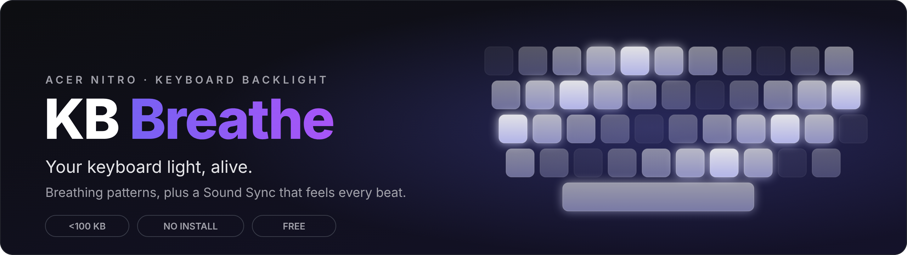
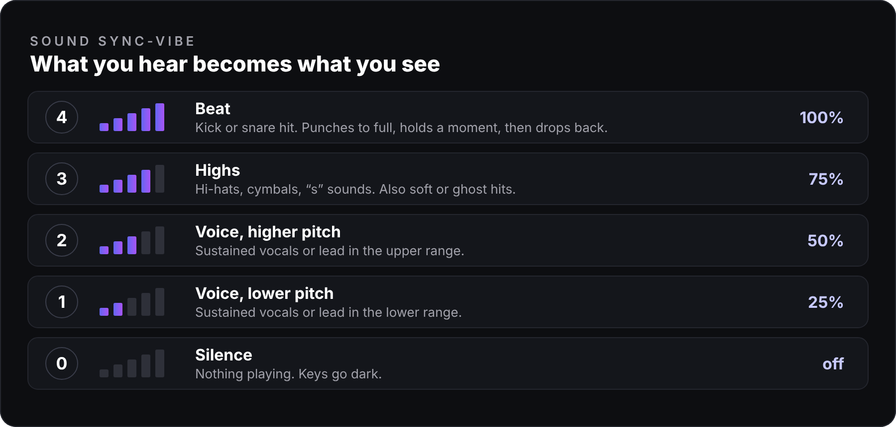

<div align="center">



<br>


-0D0E11?style=for-the-badge&logo=dotnet&logoColor=white)


[](../../releases/latest)

**One tiny `.exe`. No installer. No drivers. Nothing else to install.**

</div>

---

## Why KB Breathe?

Your Acer Nitro keyboard has four brightness steps, and NitroSense lets you pick one. **KB Breathe makes the light move.** It cycles through the steps in smooth breathing patterns, or follows whatever your PC is playing, so your keys pulse with the kick, flicker with the hats and glow with the vocals.

It lives in your system tray, starts with Windows if you want, and has global shortcuts so you never need to open a window.

## Features

- 🌬 **7 breathing patterns plus Custom.** Soft wave, Deep wave, Rise 1–4, Rise 0–4, Gentle wave, Fade out and Pulse, or write your own sequence with **Custom**. Five speed presets from *Glacial* to *Turbo*.
- 🎵 **Three Sound Sync modes.** Beat, Overall and **Vibe** (see below). Works with anything playing on your PC: Spotify, YouTube, games, local files.
- ⌨ **Global shortcuts.** Change mode or start/stop from anywhere, even with the window hidden.
- 🔔 **Keyboard reactions.** A little flash when you change power mode, plug in the charger, or unplug it.
- ⚡ **Live changes.** Switch pattern, speed or sensitivity while it runs. It applies instantly.
- 🪶 **Tiny and quiet.** Under 100 KB, uses the .NET Framework that is already part of Windows.
- 🎛 **Clean dark UI** with a live level meter, tray icon and startup options.

## Sound Sync-Vibe

<div align="center">

</div>

<br>

Pick **Sound Sync-Vibe** from the pattern list. Three layers run together and the brightest one wins:

- **Beat → 4.** A kick or snare punches the keys to full for a moment, then drops straight to whatever is still playing.
- **Highs → 3.** Hi-hats, cymbals and "s" sounds. Soft or ghost hits also land here.
- **Voice → 1 or 2.** Sustained vocals or leads light the keys softly; a **higher pitch** goes brighter than a **lower pitch**.
- **Silence → 0.** Nothing playing, keys off.

It adapts to each song's loudness on its own, and the **Sensitivity** slider (1 to 10) lets you tune it. Levels never chatter: a level is held for at least 60 ms before it can drop, so it feels like rhythm, not flicker.

| Mode | What it does | Best for |
|---|---|---|
| **Sound Sync-Vibe** | Beat, highs and voice each get their own brightness | Music with vocals, general "vibe" |
| **Sound Sync-Beat** | Only kick/snare hits flash the keys, sustained sound stays dark | Electronic, drums, bass-heavy tracks |
| **Sound Sync** | Follows the whole tune's loudness, smoothly | Ambient, cinematic, background listening |

> **Heads-up:** a frequency split can't tell a singer from a guitar or synth lead, so "voice" means any sustained sound between 300 Hz and 3.4 kHz. Pitch is relative to each song's own range.

## Quick start

1. Download **`KbBreathe.exe`** from the [latest release](../../releases/latest).
2. **Close NitroSense** (it can lock the keyboard device).
3. Double-click `KbBreathe.exe`, pick a pattern, press **Start**.

That's it. Close the window and it keeps running in the tray.

<!--
SCREENSHOTS: take 2-3 screenshots of the app and upload them next to README.md (e.g. screenshot-dash.png).
Then remove the comment wrapper around this block (the first and last line of it)
so the images below show up on your page.

<div align="center">
 
</div>
-->

## Shortcuts

Work everywhere, even when the window is hidden in the tray. You can change them on the **KEYS** page.

| Action | Default |
|---|---|
| Cycle light mode | `Ctrl` + `Alt` + `M` |
| Start / stop | `Ctrl` + `Alt` + `B` |

## Keyboard reactions

Optional flashes for system changes you might not be looking at. Each plays 0-1-2-3-4-3-2-1-0 on the keyboard (about 0.6 s), then hands the keys back to whatever was running. All off by default.

- **Power mode change** (Quiet / Balanced / Performance / Turbo, e.g. via the Nitro key). The keys step up to the height of the new mode: Quiet 1, Balanced 2, Performance 3, Turbo 4.
- **Charger plugged in**
- **Charger unplugged**

## Compatibility

Built for **Acer Nitro laptops with the 4-step keyboard backlight** (the one NitroSense controls). It talks to the keyboard controller over HID and falls back to WMI if that isn't available.

**Does it work on your Nitro?** Please [open an issue](../../issues) and tell me your model, so I can build a list.

## Troubleshooting

| Problem | Fix |
|---|---|
| *"No backlight interface found"* | Close **NitroSense** / OpenSense completely (check the tray), then try again. |
| Sound Sync doesn't react after changing speakers or headphones | It follows the device that was default when you pressed Start. Press **Stop**, then **Start**. |
| Sound Sync is too busy or too calm | Move the **Sensitivity** slider. Lower = calmer, higher = more reactive. |
| Windows or antivirus warns about the exe | It's a small unsigned hobby app that talks to hardware, which some scanners dislike. The full source is in this repo, so you can read it or build it yourself. |

## Build from source

You need the [.NET SDK](https://dotnet.microsoft.com/download) (6, 7, 8 or 9) on Windows.

```bat
build.bat
```

This builds `dist\KbBreathe.exe`. The project is a single file, `Program.cs`, with no dependencies.

## Contributing

Ideas, bug reports and pull requests are welcome. If a song feels wrong in Sound Sync-Vibe, open an issue with the song and what you expected to see. The tuning constants sit at the top of the `SoundSync` class.

## Disclaimer

KB Breathe is an independent hobby project and is **not affiliated with or endorsed by Acer**. It sends the same kind of backlight commands as NitroSense, but you use it **at your own risk**.

## License

[MIT](LICENSE). Free to use, change and share.

---

<div align="center">
<sub>If KB Breathe made your keyboard feel alive, a ⭐ on the repo helps other Nitro owners find it.</sub>
</div>
